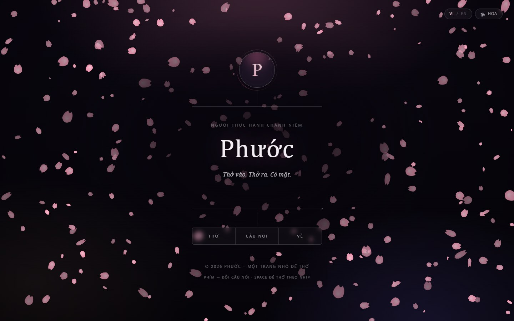
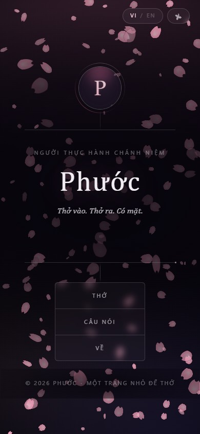

# Phước — Tỉnh thức &amp; Chánh niệm

Một trang cá nhân tối giản, một màn hình duy nhất: ảnh đại diện, tên, một câu nói xoay vòng,
ba lối vào nhỏ, và cánh hoa anh đào rơi phía sau.

Không cần build, không thư viện ngoài, không framework. Chỉ HTML, CSS và JavaScript thuần —
tải thư mục lên hosting tĩnh là chạy.



<p align="center">
	
</p>

## Có gì trong này

- **Cảnh hoa anh đào bằng WebGL**: mỗi cánh hoa là một quad, toàn bộ chuyển động (rơi, trôi,
  xoay, lật) tính trên GPU trong vertex shader; hình cánh vẽ bằng hàm khoảng cách có dấu trong
  fragment shader nên không cần texture. Độ nhoè mô phỏng xoá phông theo khoảng cách tới mặt
  phẳng nét.
- **Tự lùi về Canvas 2D** khi máy không có WebGL, và có ba chế độ chọn tay: *Hoa* · *Nhẹ* · *Tĩnh*
  (nhớ lựa chọn trong `localStorage`).
- **Song ngữ Việt / Anh**, đổi bằng nút ở góc trên phải, nhớ ngôn ngữ đã chọn.
- **Ba bảng nội dung**: nhịp thở 4 · 2 · 6, danh sách câu nói, và lời giới thiệu.
- **Tôn trọng người xem**: `prefers-reduced-motion` tắt hoa và tự chọn chế độ tĩnh, có liên kết
  "Tới nội dung", bẫy focus trong hộp thoại, đóng bằng `Esc`, mọi nút đều có nhãn đọc màn hình.
- Ảnh đại diện, favicon và ảnh xem trước đều được sinh bằng script Python trong repo.

## Xem thử tại máy

Cần Node.js 18 trở lên (không cần `npm install`):

```bash
npm start
# mở http://127.0.0.1:4173
```

Hoặc dùng bất kỳ máy chủ tĩnh nào:

```bash
python -m http.server 4173
```

Mở thẳng `index.html` bằng trình duyệt cũng được, nhưng nên chạy qua máy chủ để đường dẫn
tương đối và favicon hoạt động đúng.

## Cấu trúc

```
.
├── index.html                    # toàn bộ khung trang
├── styles/
│   ├── base.css                  # biến thiết kế, reset, typography
│   ├── pages/home.css            # bố cục, responsive, hiệu ứng mở trang
│   ├── components/overlay.css    # hộp thoại và ba bảng nội dung
│   └── utilities/noscript.css    # dự phòng khi tắt JavaScript
├── scripts/
│   ├── app/
│   │   ├── content.js            # ✏️ toàn bộ chữ nghĩa, sửa ở đây
│   │   ├── i18n.js               # chuyển Việt / Anh
│   │   └── home.js               # mở trang, xoay câu nói, hộp thoại, nhịp thở
│   ├── effects/sakura/
│   │   ├── config.js             # ✏️ thông số cảnh hoa
│   │   ├── math.js               # ma trận 4x4
│   │   ├── shaders.js            # GLSL
│   │   ├── gl-utils.js           # biên dịch shader
│   │   ├── renderer.js           # renderer WebGL
│   │   ├── canvas2d.js           # bản dự phòng Canvas 2D
│   │   └── scene.js              # chọn chế độ, vòng lặp, resize
│   ├── assets/make-avatar.py     # sinh ảnh đại diện + favicon
│   └── serve.mjs                 # máy chủ tĩnh để xem thử
└── images/
    ├── branding/                 # avatar, favicon
    └── previews/                 # ảnh xem trước cho README
```

## Tuỳ biến

### 1. Chữ nghĩa — `scripts/app/content.js`

Mọi câu chữ nằm trong một object, chia hai ngôn ngữ `vi` và `en`:

- `meta` — tiêu đề tab, mô tả SEO.
- `ui` — nhãn giao diện, nội dung ba bảng.
- `quotes` — các câu nói xoay vòng ở giữa trang (hai mảng phải **cùng số phần tử**).

Thẻ `data-i18n="khoá"` trong `index.html` sẽ tự nhận chuỗi tương ứng. Sửa tên, câu nói hay lời
giới thiệu chỉ cần sửa file này.

### 2. Ảnh đại diện

Thay `images/branding/avatar.png` bằng ảnh của bạn (nên là ảnh vuông, từ 512 px trở lên).
Muốn dùng lại ảnh sinh sẵn:

```bash
python scripts/assets/make-avatar.py    # cần Pillow
```

Script vẽ chữ lồng "P" trên nền tối; sửa `TOP`, `BOTTOM`, `PINK` hoặc chữ trong `build_avatar()`
nếu muốn khác.

> Tên file favicon là `images/branding/favicon.svg`, `favicon.png` được sinh kèm để dự phòng.

### 3. Màu sắc và chữ

Sửa các biến trong `styles/base.css`:

```css
--color-bg: #08060d;        /* nền */
--color-accent: #ff9dbb;    /* hồng nhấn */
--font-display: Cambria, "Palatino Linotype", Palatino, "Times New Roman", serif;
```

Lưu ý về font: Georgia (mặc định trên Windows) **thiếu nhiều glyph tiếng Việt dựng sẵn** —
chữ "tỉnh", "thở", "mất" sẽ hiện sai dấu. Stack hiện tại dùng Cambria, đã kiểm tra đủ dấu tiếng
Việt. Nếu đổi font, nhớ thử lại các câu có dấu nặng, dấu hỏi, dấu ngã.

### 4. Cảnh hoa — `scripts/effects/sakura/config.js`

| Nhóm | Ý nghĩa |
| --- | --- |
| `petals.count` | số cánh hoa cho từng chế độ và từng loại màn hình |
| `petals.size` | khoảng kích thước |
| `motion` | tốc độ rơi, độ trôi, biên độ đung đưa, tốc độ xoay |
| `depthOfField` | mặt phẳng nét, biên độ nhoè, độ mờ và độ sáng của lớp xa |
| `color` | ba màu pha trộn trên cánh hoa |
| `canvas2d` | số cánh và tốc độ của bản dự phòng |

Muốn nhiều hoa hơn cho màn hình lớn: tăng `petals.count.webgl.desktop`. Muốn cảnh nhẹ hơn:
giảm số lượng và tăng `depthOfField.softnessFar`.

## Bàn phím

| Phím | Tác dụng |
| --- | --- |
| `→` / `←` | câu nói tiếp theo / trước đó |
| `Space` | mở bảng nhịp thở |
| `Tab` | di chuyển trong hộp thoại (được giữ vòng bên trong) |
| `Esc` | đóng hộp thoại |

## Triển khai

Trang là tệp tĩnh, đăng ở đâu cũng được.

**GitHub Pages** — repo đã kèm workflow `.github/workflows/pages.yml`. Đẩy lên nhánh `main`, sau
đó vào *Settings → Pages → Source* chọn **GitHub Actions**.

**Netlify / Vercel / Cloudflare Pages** — trỏ vào repo, để trống lệnh build, thư mục xuất bản là
`.`.

**Hosting thường** — tải toàn bộ thư mục lên `public_html` là xong.

## Ghi công

Bố cục một màn hình với ảnh đại diện tròn, tên đặt giữa hai đường kẻ mảnh và thanh điều hướng
lấy cảm hứng từ [Dimension](https://html5up.net/dimension) của HTML5UP (CC BY 3.0), và từ
[Personal_Sakura_Guide_Page](https://github.com/NianBroken/Personal_Sakura_Guide_Page) của
NianBroken (Apache-2.0) — trang mà bạn đã gửi làm mẫu. Toàn bộ mã trong repo này được viết lại
từ đầu, không sao chép mã nguồn của hai dự án trên.

## Giấy phép

[MIT](LICENSE) © 2026 Phước
